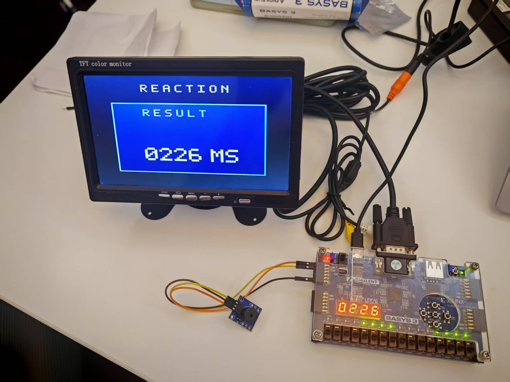
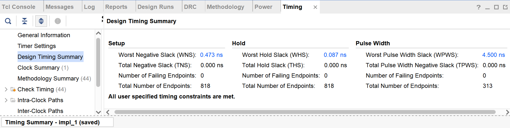

# AI-assisted RTL evaluation on Basys 3

**把 AI 初稿放回实际 FPGA 工程，用综合资源和时序报告检查隐藏的算术代价。**

这是胡家耀个人完成的《专用集成电路设计方法》课程项目：使用 Verilog、Vivado 2024.2 和 Basys 3，实现反应测试系统，并对三个 AI 初稿模块开展顶层综合对照。面向数字 IC / FPGA / AI for Semiconductor 工程评测展示。

先读 [两页技术说明](AI_RTL_Case_Study.md)，或查看 [演示视频](https://www.bilibili.com/video/BV1vc7k6WEDN/)。



## 工程与个人工作

系统实现 500–5000 ms 伪随机等待、1 ms 反应计时、提前按键／低于 100 ms／超时失败判定，以及最近三次有效成绩和平均值显示。VGA、七段数码管、LED 和蜂鸣器共享 FSM 状态与事件。输入经同步去抖和单周期脉冲处理；VGA 使用 100 MHz 时钟域内的像素使能。

本人完成需求拆解、模块集成、RTL 阅读与修改、testbench、Vivado 综合与时序分析及实板调试。ChatGPT/Codex 用于结构检查、局部 RTL 初稿、验证关注点和文字整理；最终 RTL 由本人审阅、修改并验证。`ai_drafts/` 是课程提交中保留的三份对照代码，没有完整提示词、生成日志或模型版本记录，因此不将其当作可重放的模型生成实验。

## 结果：同一顶层内同时替换三个模块

两组均使用 `reaction_top`、`xc7a35tcpg236-1`、相同 XDC 和 100 MHz（10 ns）时钟约束。`baseline` 读取最终 RTL；`ai_draft` 仅替换 `lfsr_random`、`score_history`、`buzzer_player`。原报告来自 Vivado 2024.2，**状态均为 Synthesized**。

| 综合方案 | LUT | FF | DSP | WNS/ns | TNS/ns | Setup 失败端点 |
|---|---:|---:|---:|---:|---:|---:|
| 最终 RTL（baseline） | 1486 | 312 | 1 | +0.068 | 0.000 | 0 |
| AI 初稿替换版 | 2089 | 322 | 3 | −46.225 | −1643.442 | 59 |

| 层次实例 | LUT：最终 / AI | FF：最终 / AI | DSP：最终 / AI |
|---|---:|---:|---:|
| `u_lfsr_random` | 29 / 409 | 16 / 32 | 1 / 3 |
| `u_score_history` | 703 / 380 | 41 / 41 | 0 / 0 |
| `u_buzzer_player` | 45 / 369 | 52 / 52 | 0 / 0 |

AI 替换版顶层 LUT 增加 40.6%，最差路径位于蜂鸣器的 `elapsed_ms_reg[13]/C → tone_count_reg[0]/R`：55.488 ns、140 级逻辑（111 个 CARRY4）。综合阶段布线延迟为工具估计值。最终版以参数常量预计算半周期，避免运行时变量除法；随机模块以 16 位 LFSR 与定宽乘法取高位替代 32 位 LCG 和取模。`score_history` 的 AI 初稿 LUT 更少，不能据此声称所有显式常数分支都更省面积。

层次资源受跨层优化影响，表中没有孤立模块 WNS；三个模块同时替换也不能分离每项改动对顶层时序的因果贡献。这里只评估 FPGA 资源和时序，未测量功耗，也未验证标准单元 ASIC PPA。

## 证据和验证边界

完整综合文本见 [`reports/baseline`](reports/baseline) 与 [`reports/ai_draft`](reports/ai_draft)，指标可用 Python 自动提取。证据定位、缺项和来源哈希见 [EVIDENCE.md](docs/EVIDENCE.md) 与 [source_manifest.json](reports/source_manifest.json)。

最终版的布局布线后结果仅由原课程报告第20页图19截图留存：WNS +0.473 ns、WHS +0.087 ns。没有对应的布线后 `.rpt` / checkpoint，**不能与两组综合 WNS 混成同一阶段对比**。



| 验证层次 | 已有材料 | 能支持的结论 |
|---|---|---|
| RTL 行为仿真 | 四个原始 testbench，课程报告波形／说明 | FSM 边界和历史成绩、VGA 基本时序与像素、蜂鸣器基本响应的有限用例 |
| 顶层逻辑综合 / STA | 两组资源、时序摘要、setup paths | AI 替换版可综合，但在当前 10 ns 约束下综合预估 setup 严重违例 |
| 实现后 STA | 最终版报告截图 | 已指定约束下的正裕量；没有 AI 替换版实现后结果 |
| 实板 | 最终版照片及视频链接 | 最终系统演示；不代替穷举、形式验证或外部接口时序签核 |

AI 初稿没有独立的完整功能回归或等价验证记录。两版随机算法不同；蜂鸣器在多个事件同周期出现时优先级也不同。原始 testbench 在部分 `posedge` 上驱动输入，存在仿真竞态；蜂鸣器用例仅做基础检查，VGA timing 用例检查同步脉冲／可见区是否出现，没有逐像素穷举协议。整理时保持源码原样，不以未运行的脚本或既有截图声称“本机全部测试通过”。XDC 未设置外部 I/O delay（报告列出 2 个输入、42 个输出），当前 STA 结果不代表所有板级接口时序已签核。

## 仓库结构

```text
rtl/                   11 个最终 RTL，含整机顶层
ai_drafts/              3 个同接口 AI 对照模块
sim/                    4 个原始 Verilog-2001 testbench
constraints/            Basys 3 管脚与 100 MHz 时钟约束
scripts/                综合对照、工程重建、仿真运行、指标提取
reports/{baseline,ai_draft}/  每组四份综合文本报告（脱敏副本）
reports/source_manifest.json 原件与公开副本 SHA-256 及变换说明
assets/                 两张从原报告提取的图片
docs/EVIDENCE.md         证据定位、实验边界、整理验证记录
AI_RTL_Case_Study.md     招聘技术附件
```

## 复现

### 1. 无 EDA 依赖查看既有结果

在仓库根目录运行（Python 3.9+，仅标准库）：

```bash
python3 scripts/summarize_reports.py
```

终端输出顶层表，`build/summary/` 生成 CSV / JSON。空白的模块 WNS 表示没有测得该指标。

### 2. 运行最终版原始仿真

Vivado 2024.2 环境已加入 PATH 后运行（Windows 可在 Vivado 命令环境使用 `python`）：

```bash
python3 scripts/run_sim.py --simulator xsim
```

可选 Icarus Verilog：`python3 scripts/run_sim.py --simulator iverilog`。按 Verilog-2001 编译，避免把原 testbench 中的 `expect` 任务解释为 SystemVerilog 关键字。脚本只读取 `rtl/`，**不仿真 AI 初稿**。检查工具退出码、失败文本和通过标记；日志写入 `build/sim/`。若因原 testbench 竞态出现模拟器间差异，应先在独立实验分支中修正驱动时序并重新验证，不能忽略失败文本。

### 3. 复现综合对照（可选）

```bash
vivado -mode batch -source scripts/run_synth_case.tcl -tclargs baseline
vivado -mode batch -source scripts/run_synth_case.tcl -tclargs ai_draft
python3 scripts/summarize_reports.py --reports build/synth --output build/rerun_summary
```

脚本复用原提交实验，仅调整路径和输出目录；不执行布局布线。新报告写入 `build/synth/`，不覆盖既有证据。资源／时序可能随工具版本和优化过程变化。不要把 `rtl/*.v` 和全部 `ai_drafts/*.v` 直接一起编译，它们有同名模块。

### 4. 重建 Vivado 工程与上板（可选）

```bash
vivado -mode batch -source scripts/create_project.tcl
```

打开 `build/reaction_project/reaction_project.xpr`。仿真切换 `sim_1` 顶层以运行四个 testbench；实现时顶层为 `reaction_top`。在 GUI 中按需执行综合、实现、生成 bitstream 和 Hardware Manager 下载。START 为 btnC，REACT 为 btnU；VGA 接显示器；无源蜂鸣器 IO 为 JA1 / J1，VCC 为 JA6（3.3 V），GND 为 JA5。系统使用上电计数复位，没有独立复位按钮。

## 公开范围与许可

本仓库保留展示必需的源码和证据，未包含简历、原报告全文、学号、主机名、绝对本地路径、Vivado 导入副本、工程缓存、bitstream。原始设计文件未改动；报告仅脱敏 Host、绝对输出路径并统一换行，版权声明保留。

原课程材料未附开源许可证；本次**不擅自添加 MIT 等授权**。公开可供招聘评审，代码与文档未授予额外开源使用许可。工具生成报告中的第三方权利声明继续有效，详见 [LICENSE](LICENSE)。
